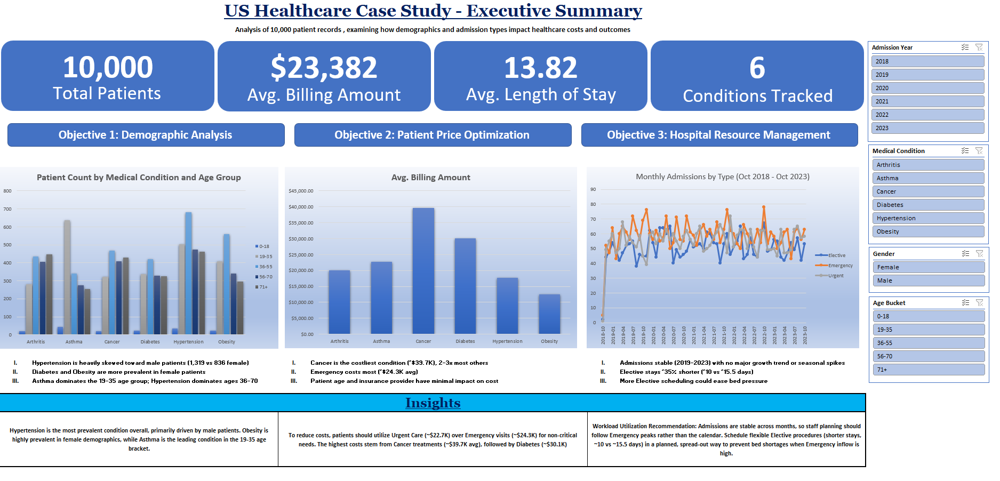
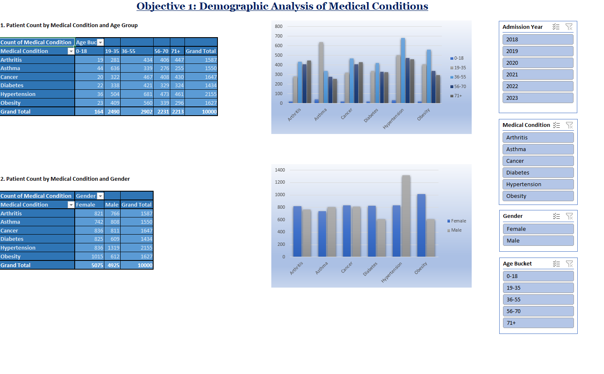
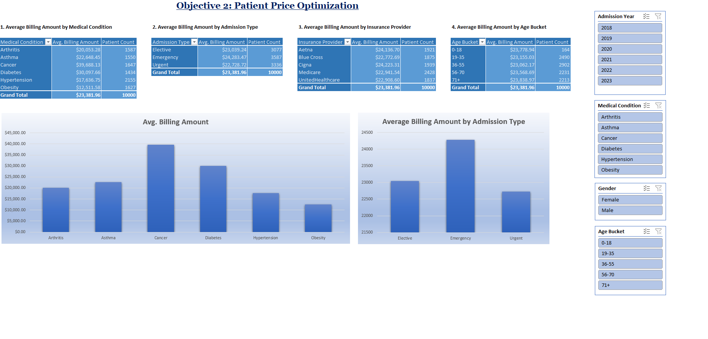
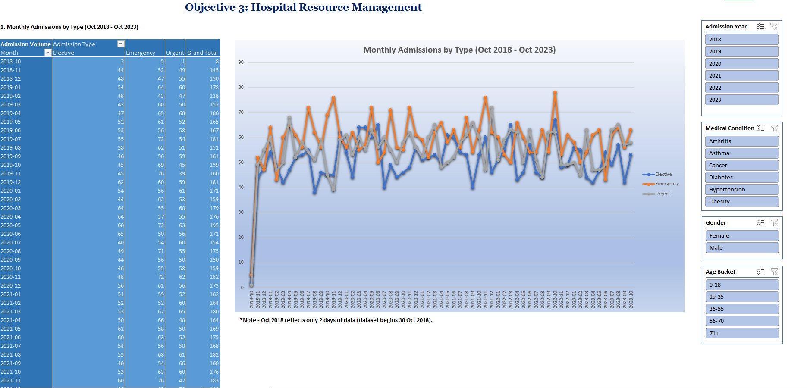

# US Healthcare Case Study – Excel Dashboard

An interactive Excel dashboard built on **10,000 patient records (Oct 2018 – Oct 2023)** to understand who the patients are, what drives hospital costs, and how admissions can be managed better.

> Project completed as part of my Data Analytics course (Coding Ninjas × IITM Pravartak).



## Business Questions

| # | Objective | Question answered |
|---|-----------|-------------------|
| 1 | Demographic Analysis | Which conditions affect which age groups and genders? |
| 2 | Patient Price Optimization | What drives billing cost – condition, admission type, insurance, or age? |
| 3 | Hospital Resource Management | Are admissions seasonal, and how can bed pressure be reduced? |

## Key Numbers

| Total Patients | Avg. Billing | Avg. Length of Stay | Conditions |
|:-:|:-:|:-:|:-:|
| 10,000 | $23,382 | 13.82 days | 6 |

## Key Findings

**1. Demographics**
- **Hypertension** is the most common condition (2,155 patients) and is strongly male-skewed (1,319 male vs 836 female).
- **Diabetes** and **Obesity** are more common in female patients (Obesity: 1,015 F vs 612 M).
- **Asthma** is the top condition for ages 19–35; **Hypertension** leads for ages 36–70.

**2. Cost**
- **Cancer** is the costliest condition (~$39.7K avg), well above Diabetes (~$30.1K) and roughly 1.8–3x the other four conditions. Obesity is the cheapest (~$12.5K).
- **Emergency** admissions cost the most (~$24.3K) vs **Urgent** (~$22.7K).
- Age and insurance provider have very little effect on cost (all averages stay within ~$22.7K–$24.2K).

**3. Hospital Resources**
- Monthly admissions are **stable from 2019 to 2023** – no strong growth trend or seasonal spikes.
- **Elective** stays are ~35% shorter (~10 days) than Emergency/Urgent stays (~15.5 days).
- Scheduling more elective procedures in a planned way can ease bed pressure during Emergency peaks.

## Recommendations
- Use **Urgent Care instead of Emergency** where the case allows – it is cheaper by ~$1.5K per patient.
- Target **preventive care** for Cancer and Diabetes, the highest-cost conditions.
- **Scale staff dynamically** around Emergency peaks and spread elective procedures to avoid bed shortages.

## Dashboard Pages

| Page | Preview |
|------|---------|
| Objective 1 – Demographic Analysis |  |
| Objective 2 – Price Optimization |  |
| Objective 3 – Resource Management |  |

## How It Was Built (Excel)

- **Data cleaning & preparation** in the `Cleaned Data` sheet; added calculated columns: *Length of Stay*, *Age Bucket*, *Admission Year*, *Admission Month*, *Year-Month*.
- **PivotTables** for every analysis (counts, averages, monthly trends).
- **Pivot Charts** (column and line charts) linked to the pivots.
- **Slicers** (Admission Year, Medical Condition, Gender, Age Bucket) to filter the whole dashboard interactively.
- **KPI cards** and written insights on the `Dashboard` sheet.

**Tools:** Microsoft Excel (PivotTables, PivotCharts, Slicers, formulas)

## Files

```
├── README.md
├── US_Healthcare_Case_Study.xlsx   # Full workbook (open in Excel to use the slicers)
└── images/                         # Dashboard screenshots
```

> **Note:** Slicers only work in Excel – download the `.xlsx` and open it on desktop for the interactive version.
> The first month (Oct 2018) shows only 2 days of data, as the dataset starts on 30 Oct 2018.

## Author

**Shayantan Mitra** – Data Reporting & Operations Analyst
[LinkedIn](https://www.linkedin.com/in/shayantanmitra96) · [GitHub](https://github.com/Dairanji)
